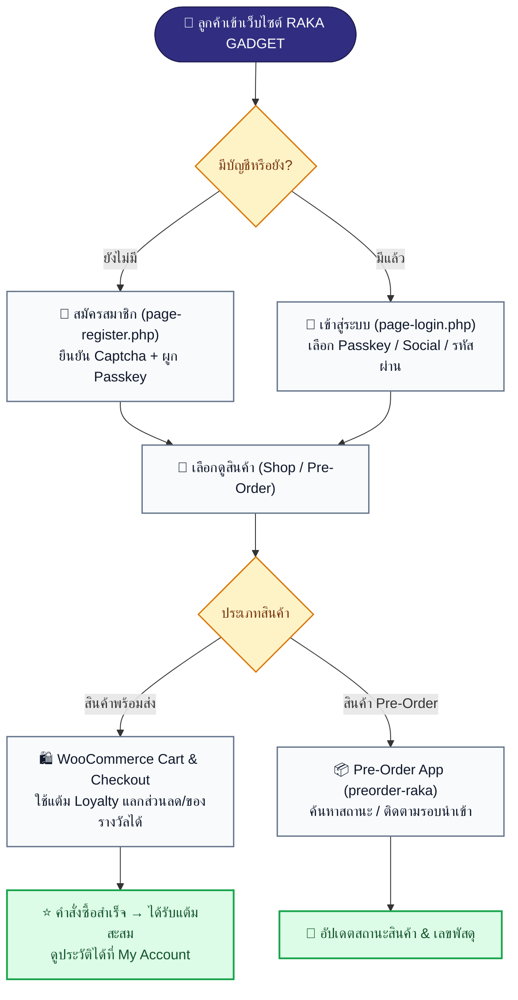
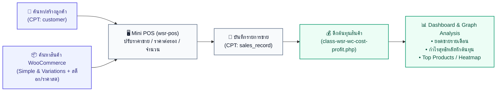
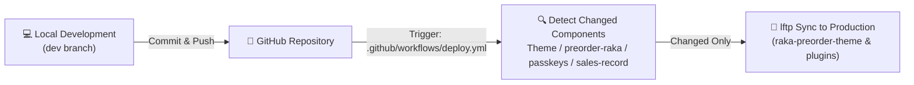

# RAKA GADGET — เอกสารภาพรวมระบบ (Project Overview & Architecture)

ระบบอีคอมเมิร์ซครบวงจรสำหรับร้าน **RAKA GADGET** พัฒนาบน **WordPress + WooCommerce** ครอบคลุมตั้งแต่หน้าบ้าน (Storefront), ระบบจองสินค้า Pre-Order, ระบบสมาชิกแบบ Passkeys & Social Login, ระบบสะสมแต้ม Loyalty ไปจนถึงระบบหลังบ้าน Mini POS และวิเคราะห์ต้นทุน-กำไร

---

## 1. แผนผังเว็บไซต์ (Sitemap)

แผนผังโครงสร้างหน้าเว็บทั้งหมดทั้งฝั่งลูกค้า (Frontend) และฝั่งผู้ดูแลระบบ (Admin / Back-Office):

```mermaid
graph TD
    classDef root fill:#1E293B,stroke:#0F172A,stroke-width:2px,color:#FFFFFF;
    classDef group fill:#EEF2FF,stroke:#4F46E5,stroke-width:1.5px,color:#312E81;
    classDef page fill:#F8FAFC,stroke:#94A3B8,stroke-width:1px,color:#0F172A;
    classDef admin fill:#ECFDF5,stroke:#059669,stroke-width:1.5px,color:#064E3B;

    Home["🏠 หน้าแรก (front-page.php)<br/>Hero, Showcase, Flash Sale & Featured"]:::root

    Home --> Shop["🛍️ ร้านค้า & สินค้า"]:::group
    Home --> PreOrder["📦 ระบบ Pre-Order"]:::group
    Home --> Auth["🔐 สมาชิก & ความปลอดภัย"]:::group
    Home --> Blog["📰 บทความ / ข่าวสาร"]:::group
    Home --> Admin["⚙️ หลังบ้าน & Mini POS"]:::admin

    Shop --> ArchiveProd["หน้ารวมสินค้า (archive-product.php)<br/>Filter / Category / Search"]:::page
    Shop --> SingleProd["หน้ารายละเอียดสินค้า (single-product.php)<br/>Variations / Add to Cart"]:::page
    Shop --> CartCheckout["ตะกร้าสินค้า & ชำระเงิน<br/>(WooCommerce Cart / Checkout + แลกแต้ม)"]:::page

    PreOrder --> PreOrderList["หน้ารวม Pre-Order (page-pre-order.php)<br/>React PreOrderApp"]:::page
    PreOrder --> PreOrderSingle["หน้ารายละเอียด Pre-Order (single-preorder.php)<br/>เช็กสถานะ / มัดจำ / Tracking"]:::page

    Auth --> Login["เข้าสู่ระบบ (page-login.php)<br/>Passkeys / Magic Link / Social Auth"]:::page
    Auth --> Register["สมัครสมาชิก (page-register.php)<br/>Captcha + Passkey Enrollment"]:::page
    Auth --> MyAccount["บัญชีของฉัน (page-my-account.php)<br/>คำสั่งซื้อ / แต้ม Loyalty / Passkeys"]:::page

    Blog --> ArchivePost["รวมบทความ (archive.php)"]:::page
    Blog --> SinglePost["อ่านบทความ (single.php)"]:::page

    Admin --> WSR_POS["Mini POS (wsr-pos)<br/>เปิดบิลหน้าร้าน / แชท / ตัดสต็อก WC"]:::admin
    Admin --> WSR_Dash["Dashboard & Graph Analysis<br/>ยอดขาย / กำไรสุทธิ / Heatmap"]:::admin
    Admin --> WSR_Sales["จัดการรายการขาย & ลูกค้า<br/>CPT: sales_record & customer"]:::admin
    Admin --> PreOrderAdmin["จัดการ Pre-Order<br/>AdminAddPreorder / Import-Export"]:::admin
```



---

## 2. แผนภาพขั้นตอนการทำงาน (Flowcharts)

### 2.1 โฟลว์ฝั่งลูกค้า: เข้าสู่ระบบ สั่งซื้อ Pre-Order และสะสมแต้ม (Customer Journey)



---

### 2.2 โฟลว์ฝั่งร้านค้า: Mini POS, บันทึกขาย และวิเคราะห์กำไร (Back-Office & POS Flow)



---

### 2.3 โฟลว์การพัฒนาและ Deploy อัตโนมัติ (CI/CD Workflow)



---

## 3. โครงสร้างโมดูลหลักในโปรเจกต์ (Modules)

| โมดูล | ตำแหน่งโฟลเดอร์ | หน้าที่หลัก |
| :--- | :--- | :--- |
| **Theme หลัก** | `app/public/wp-content/themes/raka-preorder-theme/` | ธีมหลักของร้าน รองรับ Tailwind CSS, Dark/Light Mode, WooCommerce Templates, หน้า Login/Register/Account และระบบ Loyalty UI |
| **Pre-Order** | `app/public/wp-content/plugins/preorder-raka/` | ระบบจัดการออเดอร์ Pre-Order (React App + REST API + Admin Import/Export) |
| **Passkeys & Auth** | `app/public/wp-content/plugins/my-wc-passkeys/` | ระบบล็อกอินไร้รหัสผ่าน (WebAuthn Passkeys), Social Login, Magic Link และ Captcha |
| **Sales Record & POS** | `app/public/wp-content/plugins/wp-sales-record/` | ระบบบันทึกการขาย (Mini POS), จัดการข้อมูลลูกค้า, ต้นทุน-กำไรสินค้า WooCommerce และกราฟวิเคราะห์ยอดขาย |

---

## 4. คำสั่ง Build สำหรับการพัฒนา (Development Build)

เมื่อแก้ไขไฟล์ Frontend/Admin (`src/`) ใน Theme หรือ Plugin ให้รันคำสั่ง Build ก่อน Commit:

```bash
# Build Theme
npm --prefix "app/public/wp-content/themes/raka-preorder-theme" run build

# Build Plugin: wp-sales-record
npm --prefix "app/public/wp-content/plugins/wp-sales-record" run build

# Build Plugin: preorder-raka
npm --prefix "app/public/wp-content/plugins/preorder-raka" run build
```
