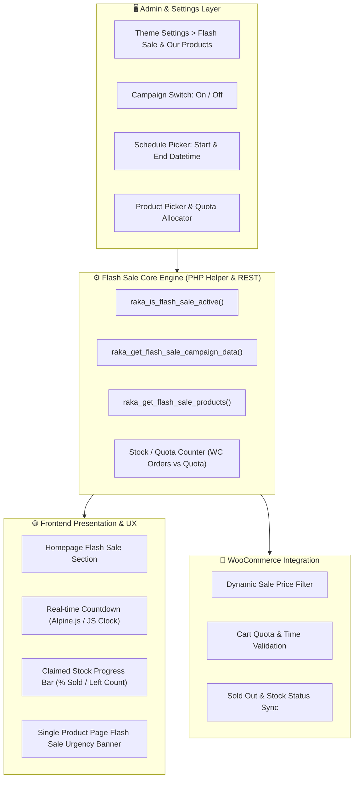

# ⚡ แผนการพัฒนาระบบ Flash Sale (Flash Sale System Plan)
**โครงการ:** Raka Pre-Order & Gadget Theme  
**สถานะ:** รอเริ่มการพัฒนา (Planning & Architecture)  
**เป้าหมาย:** สร้างระบบ Flash Sale ที่ครบวงจร ยืดหยุ่น รองรับการตั้งเวลาจริง สต็อกโควต้า และการจัดการผ่าน WordPress Admin ได้อย่างสมบูรณ์

---

## 📌 1. ภาพรวมสถาปัตยกรรมระบบ (System Architecture)



---

## 🎯 2. รายละเอียดฟังก์ชันและส่วนประกอบของระบบ (Functional Specs)

### 2.1 🕒 ระบบแคมเปญและการตั้งเวลา (Campaign Scheduling)
* **Status Switch:** เปิด-ปิด ระบบ Flash Sale ทั้งเว็บแบบ Master Toggle
* **Datetime Schedule:**
  - กำหนดวันและเวลาเริ่มต้น (`flash_sale_start_time` - เช่น `2026-09-28 18:00:00`)
  - กำหนดวันและเวลาสิ้นสุด (`flash_sale_end_time` - เช่น `2026-09-30 23:59:59`)
* **Auto Expiry & Dynamic Status:**
  - **Upcoming (เร็วๆ นี้):** แจ้งเตือนเริ่มในอีก... (Starts In)
  - **Live / Running (กำลังจัดรายการ):** นับถอยหลังเวลาหมด (Ends In) พร้อมเปิดรับคำสั่งซื้อ
  - **Ended (หมดเวลา):** ซ่อน Section หรือแสดงข้อความว่าแคมเปญสิ้นสุดแล้ว พร้อมรีเซ็ตราคาสินค้าเป็นปกติ

---

### 2.2 🛍️ ระบบคัดเลือกสินค้าและจัดการราคา (Product Selection & Pricing)
รองรับ 2 โหมดการทำงาน:
1. **Manual Mode (โหมดคัดสรรเฉพาะ):**
   - แอดมินสามารถค้นหาและเลือกสินค้าเข้าร่วม Flash Sale ได้เป็นรายชิ้น (ผ่าน React Product Search Picker ใน Theme Settings)
   - กำหนด **Flash Sale Price (ราคาพิเศษเฉพาะช่วงนี้)** แยกจาก Regular Price
   - กำหนด **Flash Sale Quota (จำนวนโควต้าสินค้า)** เช่น ให้สิทธิ์ราคานี้แค่ 10 ตัวแรก
2. **Automatic Mode (ดึงสินค้าลดราคาใน WooCommerce):**
   - โหมด Fallback: หากไม่ได้เลือกสินค้าไว้ จะดึงสินค้าที่มีสถานะ `on_sale = true` ในระบบ WooCommerce มาแสดงอัตโนมัติ

---

### 2.3 📊 สต็อกโควต้าและแถบความเร่งด่วน (Quota Tracking & Claimed Urgency)
* **Real-time Quota Calculation:**
  - `Claimed % = (ยอดสั่งซื้อในช่วงแคมเปญ / โควต้าทั้งหมด) * 100`
  - `Left Count = โควต้าทั้งหมด - ยอดสั่งซื้อในช่วงแคมเปญ`
* **Sold Out Fallback:**
  - เมื่อสินค้าถูกสั่งซื้อครบโควต้า ระบบจะแสดง Badge **"SOLD OUT"** หรือสลับกลับไปเป็นราคาปกติอัตโนมัติ
* **Purchase Limit:** จำกัดจำนวนการซื้อไม่เกิน 1-2 ชิ้นต่อคน/ออเดอร์ เพื่อป้องกันการกว้านซื้อไปขายต่อ

---

### 2.4 🎨 การแสดงผลบนหน้าเว็บไซต์ (Frontend Display & UI)
* **🏠 หน้าแรก (Homepage Grid):**
  - แสดง Header พร้อม Pulse Dot สีแดง
  - แสดงกล่อง Countdown Timer (นับถอยหลังจริงตามเวลา Server + Client Timezone)
  - รองรับการปรับจำนวนแถวแสดงผลได้ตามที่ผู้ใช้กำหนด (1-4 แถว)
* **🛍️ หน้ารายละเอียดสินค้า (Single Product Page):**
  - แสดงแถบ Banner ป้ายแดง **"⚡ FLASH SALE DEAL"** ด้านบนปุ่ม Add to Cart แจ้งเตือนเวลาที่เหลือและจำนวนสต็อกโปรโมชั่น
* **🛒 ระบบ Cart & Checkout:**
  - ตรวจสอบราคาส่วนลด Flash Sale อัตโนมัติเมื่อเพิ่มสินค้าลงตะกร้า

---

## 🛠️ 3. การออกแบบฐานข้อมูลและการตั้งค่า (Data Schema)

ข้อมูลการตั้งค่าจะถูกจัดเก็บใน WordPress Options ผ่าน Theme Settings:

```json
{
  "flash_sale_enabled": true,
  "flash_sale_title": "FLASH SALE DEALS",
  "flash_sale_desc": "Exclusive pre-order allocations at special introductory prices.",
  "flash_sale_start": "2026-09-28 18:00:00",
  "flash_sale_end": "2026-09-30 23:59:59",
  "flash_sale_limit": 4,
  "flash_sale_mode": "manual",
  "flash_sale_items": [
    {
      "product_id": 105,
      "flash_price": 2590,
      "quota": 10,
      "sold_count": 4
    },
    {
      "product_id": 112,
      "flash_price": 3890,
      "quota": 5,
      "sold_count": 2
    }
  ]
}
```

---

## 🚀 4. แผนการพัฒนาทีละเฟส (Phased Implementation Plan)

### Phase 1: Core Campaign & Real-time Live Timer (เร่งด่วน)
- [ ] เพิ่มการตั้งค่า `flash_sale_enabled`, `flash_sale_start`, `flash_sale_end` ใน Theme Settings (`ThemeSettingsApp.jsx` + `inc/theme-options.php`)
- [ ] เขียน Helper Function `raka_get_flash_sale_campaign_data()` ใน `inc/helpers.php` เพื่อเช็คสถานะและเวลาที่เหลือ
- [ ] พัฒนา Real-time Live Countdown Timer ด้วย Alpine.js ใน `front-page.php` ให้รันนับถอยหลังวินาทีต่อวินาทีจริง

### Phase 2: Product Picker & Quota Management
- [ ] พัฒนา UI ใน Theme Settings ให้สามารถ Search / Add สินค้าที่ต้องการจัด Flash Sale พร้อมระบุราคาและจำนวนโควต้า
- [ ] เชื่อมต่อ API บันทึกและดึงข้อมูลสินค้าเข้าร่วม Flash Sale
- [ ] แสดงผลแถบ Claimed % และ Left Count ตามข้อมูลที่กำหนดในระบบ

### Phase 3: WooCommerce Hook & Single Product Integration
- [ ] เพิ่ม Flash Sale Banner ในหน้ารายละเอียดสินค้า (`single-product.php`)
- [ ] Hook ราคา Flash Sale ใน WooCommerce Cart เพื่อให้ราคาลดลงตามช่วงเวลาจริง
- [ ] เพิ่มระบบ Sold Out เมื่อสินค้าครบตามโควต้า
