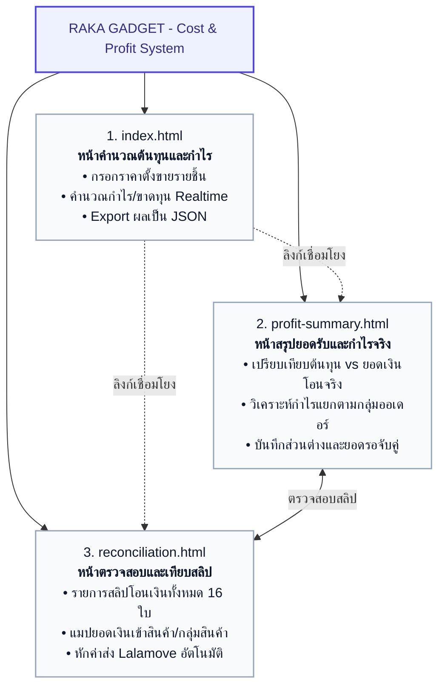
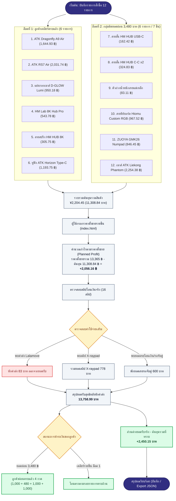
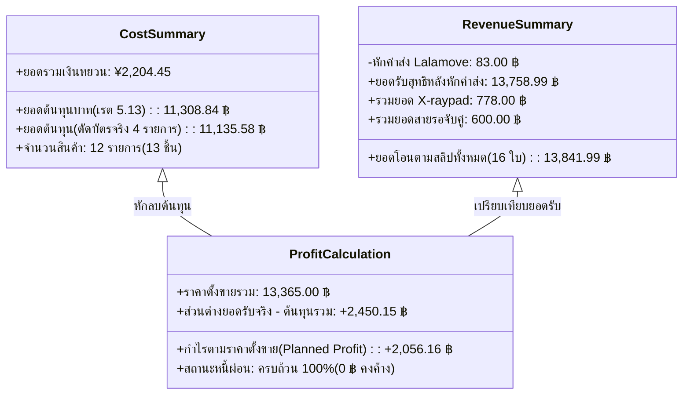

# คู่มือระบบคำนวณต้นทุน กำไร และกระทบยอดสลิป (RAKA GADGET)

เอกสารสรุปภาพรวมโครงสร้างเว็บไซต์ แผนผังหน้าจอ (Sitemap) แผนภาพขั้นตอนการทำงาน (Flowchart) และตารางวิเคราะห์ต้นทุน-กำไร-การชำระเงินของสินค้าทั้ง 12 รายการ (13 ชิ้นย่อย) เพื่อให้ตรวจสอบและทำความเข้าใจได้ง่ายในที่เดียว

---

## 1. แผนผังเว็บไซต์ (Sitemap)

ระบบคำนวณและกระทบยอดเงินประกอบด้วย 3 หน้าหลักที่เชื่อมโยงถึงกัน:

---

## 2. แผนภาพขั้นตอนการทำงาน (Flowchart)

ขั้นตอนการคำนวณต้นทุน กระทบยอดเงินโอนจากสลิป และคำนวณกำไรสุทธิ:

---

## 3. ตารางรายละเอียดสินค้าและต้นทุนทั้ง 12 รายการ (13 ชิ้น)

> [!NOTE]
> - อัตราแลกเปลี่ยนอ้างอิง: **5.13 บาท / หยวน (¥)**
> - สายสั้น HM HUB C-C (ลำดับที่ 8) มีจำนวน 2 เส้น จึงแยกคำนวณเป็นเส้นละ ¥31.66 (162.42 ฿ + 162.41 ฿) เพื่อให้ตรงกับยอด 324.83 บาท

### ล็อตที่ 1: รายการช่วง ก.ย. – ต้น ต.ค. (ลูกค้าเคลียร์รายชิ้นครบแล้ว)

| ลำดับ | รายการสินค้า | รายละเอียด / สเปก | แพลตฟอร์ม | ต้นทุนหยวน (¥) | ต้นทุนบาท (฿) | ราคาตั้งขาย (฿) | กำไรตามตั้งขาย (฿) | สถานะสลิป |
| :---: | :--- | :--- | :--- | :---: | :---: | :---: | :---: | :---: |
| **1** | **ATK Dragonfly A9 Air** | Master Edition ลาย Leviathan (3955) | Douyin | 320.65 | 1,644.93 | 2,190.00 | +545.07 | โอนแล้ว 2,180 ฿ |
| **2** | **ATK RS7 Air** | สวิตช์ Ice Blade ลาย Leviathan | Douyin | 396.05 | 2,031.74 | 2,300.00 | +268.26 | โอนแล้ว 3 งวด (2,300.99 ฿) |
| **3** | **แผ่นรองเมาส์ D-GLOW CLEAR** | ลาย Lumi ขนาด 420x490mm | Taobao | 185.22 | 950.18 | 1,070.00 | +119.82 | โอนแล้ว 1,070 ฿ |
| **4** | **HM Lab 8K Hub** | 1 ออก 3 รุ่น Pro Anodized Silver มีจอ | Douyin | 106.00 | 543.78 | 700.00 | +156.22 | โอนรวมสาย 1,000 ฿ |
| **5** | **สายสปริง HM HUB 8K** | สายทองแดงผลึกเดี่ยวคุมแม่เหล็ก | Pinduoduo | 59.60 | 305.75 | 350.00 | +44.25 | โอนรวมฮับ 1,000 ฿ |
| **6** | **หูฟังเกมมิ่ง ATK Horizon** | หูฟังเกมมิ่งมีสาย Type-C สี Gunmetal | Douyin | 232.70 | 1,193.75 | 1,300.00 | +106.25 | โอนแล้ว 1,350 ฿ |
| **รวม** | **ล็อตที่ 1 (6 รายการ)** | — | — | **¥1,300.22** | **6,670.13** | **7,910.00** | **+1,239.87** | **เคลียร์ครบถ้วน** |

---

### ล็อตที่ 2: รายการช่วงกลาง ต.ค. (กลุ่มยอดผ่อน 3,480 บาท + สั่งเพิ่ม)

| ลำดับ | รายการสินค้า | รายละเอียด / สเปก | แพลตฟอร์ม | ต้นทุนหยวน (¥) | ต้นทุนบาท (฿) | ราคาตั้งขาย (฿) | กำไรตามตั้งขาย (฿) | สถานะสลิป |
| :---: | :--- | :--- | :--- | :---: | :---: | :---: | :---: | :---: |
| **7** | **สายสั้น HM HUB USB-C** | ถัก 8 เส้น สีเงิน หัวเฉียง ไฟขาว+เขียว | Pinduoduo | 31.66 | 162.42 | 185.00 | +22.58 | รวมในยอดผ่อน 3,480 ฿ |
| **8.1** | **สายสั้น HM HUB C-C (เส้นที่ 1)** | รุ่น C-C22 ไฟขาว+เขียว+ปิด | Pinduoduo | 31.66 | 162.42 | 185.00 | +22.58 | รวมในยอดผ่อน 3,480 ฿ |
| **8.2** | **สายสั้น HM HUB C-C (เส้นที่ 2)** | รุ่น C-C22 ไฟขาว+เขียว+ปิด | Pinduoduo | 31.66 | 162.41 | 185.00 | +22.59 | รวมในยอดผ่อน 3,480 ฿ |
| **9** | **ตัวถ่วงน้ำหนักสายแม่เหล็ก** | ทรงสี่เหลี่ยม สีเงิน ไม่สลักลาย (1 ชิ้น) | Pinduoduo | 16.20 | 83.11 | 100.00 | +16.89 | รวมในยอดผ่อน 3,480 ฿ |
| **10** | **สายคีย์บอร์ด Hiomu Custom RGB** | หัว 1 ออก 2 ยาว 1.5m สีเงินสลับไฟ | Taobao | 188.60 | 967.52 | 1,100.00 | +132.48 | โอนแล้ว 1,000 ฿ |
| **11** | **ZUOYA GMK26 Tri-mode Numpad** | คีย์บอร์ดตัวเลข 26 ปุ่ม สีขาว | Taobao | 165.00 | 846.45 | 1,100.00 | +253.55 | รวมในยอดผ่อน 3,480 ฿ |
| **12** | **เมาส์ ATK Liekong Phantom** | Master Edition สี Dune Sand (沙丘) | Tmall | 439.45 | 2,254.38 | 2,600.00 | +345.62 | รวมในยอดผ่อน 3,480 ฿ |
| **รวม** | **ล็อตที่ 2 (6 รายการ / 7 ชิ้น)** | — | — | **¥904.23** | **4,638.71** | **5,455.00** | **+816.29** | **ผ่อนครบ 3,480 ฿ แล้ว** |

---

## 4. สรุปผลประกอบการภาพรวม (Financial Summary)

### สรุปยอดเงินสำคัญ
1. **ต้นทุนสินค้ารวม (13 ชิ้น):** **11,308.84 บาท** (¥2,204.45)
2. **ราคาตั้งขายรวม:** **13,365.00 บาท**
3. **กำไรตามราคาตั้งขาย:** **+2,056.16 บาท**
4. **ยอดเงินโอนเข้าจริง (16 สลิป):** **13,841.99 บาท**
5. **ยอดรับสุทธิ (หักค่าส่ง Lalamove 83 บ.):** **13,758.99 บาท**
6. **ส่วนต่างยอดรับจริง ลบ ต้นทุนสินค้า:** **+2,450.15 บาท** *(หมายเหตุ: ยอดรับนี้มีรวมแผ่น X-raypad 778 บ. และยอดสายรอจับคู่ 600 บ. ด้วย)*

---

## 5. ไฟล์ที่เกี่ยวข้องในโปรเจกต์
- [index.html](file:///c:/Users/akega/Local%20Sites/raka-gadget/cost-profit-calculator/index.html) — เครื่องมือคำนวณต้นทุน กำไร และ Export JSON
- [profit-summary.html](file:///c:/Users/akega/Local%20Sites/raka-gadget/cost-profit-calculator/profit-summary.html) — หน้ารวมสรุปกำไรแยกตามกลุ่มและยอดรับจริง
- [reconciliation.html](file:///c:/Users/akega/Local%20Sites/raka-gadget/cost-profit-calculator/reconciliation.html) — หน้ากระทบยอดสลิปโอนเงินทั้ง 16 ใบ
- [reconciliation-data.js](file:///c:/Users/akega/Local%20Sites/raka-gadget/cost-profit-calculator/reconciliation-data.js) — ฐานข้อมูลโครงสร้าง JSON ต้นทุน สลิป และผลลัพธ์การคำนวณ
